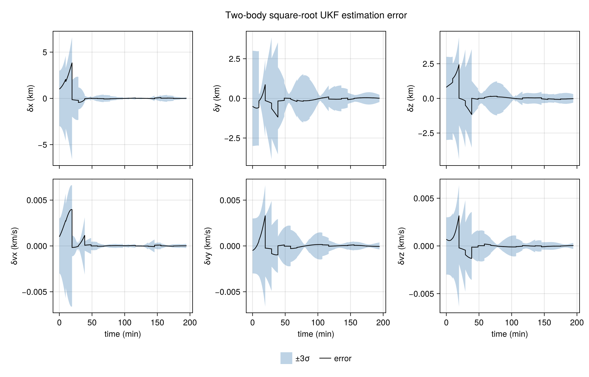

# `SequentialFilters.jl`: Sequential filters in Julia

<p align="center">
  <a href="https://explorationlogisticscontrol.github.io/SequentialFilters.jl">
    
  </a>
  <a href="https://github.com/eXplorationLogisticsControl/SequentialFilters.jl/actions/workflows/test.yml">
    
  </a>
  <!-- <a href="https://app.codecov.io/gh/eXplorationLogisticsControl/SequentialFilters.jl">
    
  </a> -->
</p>

<p align="center">
  
</p>

Sequential filters for nonlinear state estimation. Each filter exposes the same `predict!` / `update!` loop. Covariance-form filters store `P`. Square-root filters store a lower-triangular factor `S` with `P = S*S'` and rebuild that factor with a thin QR. The [documentation](https://explorationlogisticscontrol.github.io/SequentialFilters.jl) has the predict and update equations.

## Filters

| Filter | Uncertainty | Reference |
| :--- | :--- | :--- |
| `ExtendedKalmanFilter` | covariance `P` | Kalman (1960); Joseph update of Bucy and Joseph (1968) |
| `UnscentedKalmanFilter` | covariance `P` | Wan and van der Merwe (2000) |
| `ConjugateUnscentedKalmanFilter` | covariance `P` | Adurthi, Singla, and Singh (2018) |
| `HigherOrderUnscentedEstimator` | covariance `P`, marginal skewness and kurtosis | Stojanovski and Savransky (2021) |
| `SquareRootExtendedKalmanFilter` | lower factor `S` | Kaminski, Bryson, and Schmidt (1971) |
| `SquareRootUnscentedKalmanFilter` | lower factor `S` | van der Merwe and Wan (2001) |
| `SquareRootConjugateUnscentedKalmanFilter` | lower factor `S` | Adurthi, Singla, and Singh (2018); van der Merwe and Wan (2001) |
| `SquareRootCubatureKalmanFilter` | lower factor `S` | Arasaratnam and Haykin (2009) |
| `ParticleFilter` | weighted particles | Gordon, Salmond, and Smith (1993) |

`UnscentedKalmanFilter` is the scaled unscented Kalman filter (`alpha = 1e-3`, `beta = 2`, `kappa = 0`). `ConjugateUnscentedKalmanFilter` implements CUT4 (every dimension) and CUT6 (`2 ≤ n ≤ 9`). `SquareRootCubatureKalmanFilter` is the third-degree spherical-radial rule with `2n` points. `ParticleFilter` is a bootstrap sequential importance resampling filter. `covariance` rebuilds `P = S*S'` when a square-root filter needs the full matrix.

Gaussian mixture filters and filters with consider parameters are not implemented. The consider-parameter targets are the unscented Schmidt–Kalman filter (Zanetti and DeMars, 2013; Stauch and Jah, 2015) and its square-root form (Geeraert and McMahon, 2018).

### References

- Kalman, R. E. (1960). [A New Approach to Linear Filtering and Prediction Problems](https://doi.org/10.1115/1.3662552). *Journal of Basic Engineering*, 82(1), 35–45.
- Bucy, R. S., and Joseph, P. D. (1968). *Filtering for Stochastic Processes with Applications to Guidance*. Interscience.
- Kaminski, P. G., Bryson, A. E., and Schmidt, S. F. (1971). [Discrete Square Root Filtering: A Survey of Current Techniques](https://doi.org/10.1109/TAC.1971.1099816). *IEEE Transactions on Automatic Control*, 16(6), 727–736.
- Gordon, N. J., Salmond, D. J., and Smith, A. F. M. (1993). [Novel approach to nonlinear/non-Gaussian Bayesian state estimation](https://doi.org/10.1049/ip-f-2.1993.0015). *IEE Proceedings F*, 140(2), 107–113.
- Wan, E. A., and van der Merwe, R. (2000). [The Unscented Kalman Filter for Nonlinear Estimation](https://doi.org/10.1109/ASSPCC.2000.882463). *Proc. IEEE Adaptive Systems for Signal Processing, Communications, and Control Symposium*, 153–158.
- van der Merwe, R., and Wan, E. A. (2001). [The Square-Root Unscented Kalman Filter for State and Parameter-Estimation](https://doi.org/10.1109/ICASSP.2001.940586). *Proc. IEEE ICASSP*, 3461–3464.
- Arasaratnam, I., and Haykin, S. (2009). [Cubature Kalman Filters](https://doi.org/10.1109/TAC.2009.2019800). *IEEE Transactions on Automatic Control*, 54(6), 1254–1269.
- Adurthi, N., Singla, P., and Singh, T. (2018). [Conjugate Unscented Transformation: Applications to Estimation and Control](https://doi.org/10.1115/1.4037783). *ASME Journal of Dynamic Systems, Measurement, and Control*, 140(3), 030907.
- Stojanovski, Z., and Savransky, D. (2021). [Higher-Order Unscented Estimator](https://doi.org/10.2514/1.G006109). *Journal of Guidance, Control, and Dynamics*, 44(12), 2186–2198.

## Installation

Clone this repository, change to the project that will use it, and add the local path from the package manager:

```bash
git clone https://github.com/eXplorationLogisticsControl/SequentialFilters.jl.git
cd /path/to/your/project
julia --project=.
```

```julia-repl
pkg> add path/to/SequentialFilters.jl
```

`path/to/SequentialFilters.jl` is the directory created by `git clone`. The quick start integrates the orbit with `OrdinaryDiffEq` and builds the measurement Jacobian with `ForwardDiff`, so add those packages to the same project:

```julia-repl
pkg> add OrdinaryDiffEq ForwardDiff
```

## Quick start

A circular 7000 km orbit is estimated from range and range-rate measured by a rotating ground station. The dynamics, the initial error, and the noise are the ones in [`demo/twobody/demo_ekf.jl`](demo/twobody/demo_ekf.jl). The figure above is the square-root unscented filter on this same scenario. The snippet takes ten measurements per orbit for two orbits.

```julia
using ForwardDiff
using LinearAlgebra
using OrdinaryDiffEq
using Random
using SequentialFilters

μ = 3.986004418e5          # km³/s²
R_E = 6378.137             # km
ω_E = 7.292115146706979e-5 # rad/s
a = 7000.0                 # km
inc = deg2rad(51.6)
lat = deg2rad(28.5)
lon0 = 0.0

function twobody!(du, u, p, t)
    du[1:3] = u[4:6]
    du[4:6] = -μ * u[1:3] / norm(u[1:3])^3
    return nothing
end

period = 2π * sqrt(a^3 / μ)
Δt = period / 10
n_meas = 20

function station_state(t)
    cφ, sφ = cos(lat), sin(lat)
    λ = lon0 + ω_E * t
    cλ, sλ = cos(λ), sin(λ)
    rs = R_E .* (cφ * cλ, cφ * sλ, sφ)
    vs = (ω_E * R_E) .* (-cφ * sλ, cφ * cλ, 0.0)
    return rs, vs
end

function range_rangerate(t, x)
    rs, vs = station_state(t)
    ρx, ρy, ρz = x[1] - rs[1], x[2] - rs[2], x[3] - rs[3]
    ρ = sqrt(ρx * ρx + ρy * ρy + ρz * ρz)
    ρdot = (ρx * (x[4] - vs[1]) + ρy * (x[5] - vs[2]) + ρz * (x[6] - vs[3])) / ρ
    return [ρ, ρdot]
end

function get_h_H(t, x)
    yhat = range_rangerate(t, x)
    jac = ForwardDiff.jacobian(z -> range_rangerate(t, z), x)
    return yhat, jac
end

speed = sqrt(μ / a)
x0 = [a, 0.0, 0.0, 0.0, speed * cos(inc), speed * sin(inc)]
truth = solve(
    ODEProblem(twobody!, x0, (0.0, n_meas * Δt), μ),
    Tsit5();
    reltol = 1e-12,
    abstol = 1e-12,
)

σ_ρ = 0.01       # 10 m
σ_ρdot = 1.0e-5  # 1 cm/s
R = Diagonal([σ_ρ^2, σ_ρdot^2])
Random.seed!(1)
ys = map(Δt .* (1:n_meas)) do t
    y = range_rangerate(t, truth(t))
    return y .+ [σ_ρ, σ_ρdot] .* randn(2)
end

x_hat0 = x0 .+ [1.0, -0.5, 0.8, 1.0e-3, -0.5e-3, 0.7e-3]
P0 = Matrix(Diagonal([fill(1.0^2, 3); fill((1.0e-3)^2, 3)]))
dynamics = NonlinearODEModel(twobody!; n = 6, p = μ)
process_noise = UnbiasedRandomProcess(1.0e-6)
measurements = NonlinearMeasurementModel(get_h_H)

filt = ExtendedKalmanFilter(0.0, x_hat0, P0)
for k in 1:n_meas
    predict!(filt, dynamics, process_noise, Δt)
    update!(filt, measurements, ys[k], R)
end

x_true = truth(filt.t)
println("position error (km): ", norm(filt.x[1:3] .- x_true[1:3]))
println("velocity error (km/s): ", norm(filt.x[4:6] .- x_true[4:6]))
```

`predict!` integrates the two-body dynamics and the state-transition matrix, then adds the discrete process noise from `UnbiasedRandomProcess`. `update!` applies the range and range-rate Jacobian and the Joseph covariance update. Both mutate `filt`.

Derivative-free filters take `range_rangerate` instead of the Jacobian model. The same loop with an unscented filter is `filt = UnscentedKalmanFilter(0.0, x_hat0, P0)` and `update!(filt, range_rangerate, ys[k], R)`. The scripts under `demo/twobody/` run every filter in the table on this orbit, and the [two-body tutorial](https://explorationlogisticscontrol.github.io/SequentialFilters.jl/dev/tutorials/basic/) walks through the same scenario.

```bash
julia --project=demo demo/twobody/demo_ekf.jl
```
