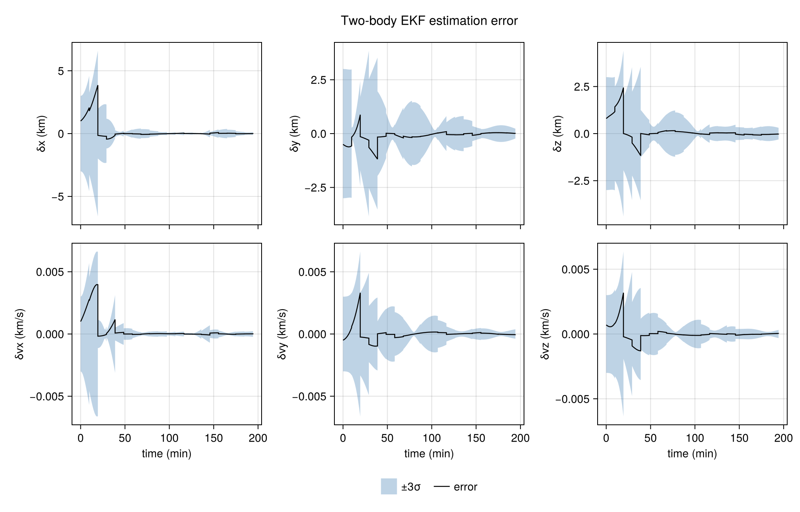

# [Two-body orbit](@id twobody-tutorial)

`demo/twobody/demo_ekf.jl` estimates a circular orbit from range and range-rate. It includes `demo/twobody/twobody_scenario.jl`, which builds the orbit, the ground station, the measurements, and the names passed to [`predict!`](@ref) and [`update!`](@ref). The script then runs an [`ExtendedKalmanFilter`](@ref) and writes the error figure below. The [extended Kalman filter](@ref ekf-tutorial) page has the predict step and the Joseph update. This page is the example those equations run on.

Position is in kilometers and velocity in kilometers per second. Time is in seconds. Angles in the source are converted with `deg2rad` and stored in radians.

```bash
julia --project=demo demo/twobody/demo_ekf.jl
```

## What the script loads

The demo activates the `demo/` project, loads CairoMakie for the figure, and includes the shared scenario. `predict!` and `update!` are the SequentialFilters methods.

```julia
import Pkg
Pkg.activate(joinpath(@__DIR__, ".."))

using CairoMakie
using LinearAlgebra

using SequentialFilters

import SequentialFilters: predict!, update!

include(joinpath(@__DIR__, "twobody_scenario.jl"))
```

Everything from the next section through `load_twobody_case` is defined by that include. The same names are what the UKF, CUT, square-root, and particle demos use.

## Constants

```julia
const μ = 3.986004418e5
const R_E = 6378.137
const ω_E = 7.292115146706979e-5
const a = 7000.0
const inc = deg2rad(51.6)
const lat = deg2rad(28.5)
const lon0 = 0.0
```

`μ` is Earth's gravitational parameter, in km³/s². `R_E` is the equatorial radius, in km, and `ω_E` is Earth's rotation rate, in rad/s. The spacecraft flies a circular orbit of radius `a` = 7000 km at inclination `inc` = 51.6°. The ground station sits at latitude `lat` = 28.5° and, at `t = 0`, at longitude `lon0` = 0.

## Dynamics

`twobody!` is the in-place two-body vector field. The state is `[x, y, z, vx, vy, vz]`. Position rate is velocity, and acceleration is the inverse-square gravity of a point mass `μ`:

```math
\dot{\mathbf{r}} = \mathbf{v}, \qquad
\dot{\mathbf{v}} = -\mu\, \mathbf{r} / \|\mathbf{r}\|^3.
```

```julia
function twobody!(du, u, p, t)
    du[1:3] = u[4:6]
    du[4:6] = -μ * u[1:3] / norm(u[1:3])^3
    return nothing
end
```

The function reads the global `μ`. The ODE parameter `p` is still set to `μ` on the truth problem and on the filter's dynamics model, which keeps the call in the usual `(du, u, p, t)` form.

## Measurement schedule

```julia
const period = 2π * sqrt(a^3 / μ)
const Δt = period / 10
const n_orbits = 2
const n_meas = 10 * n_orbits
const n_save = 9
```

`period` is the Keplerian period of the circular orbit. `Δt` is one tenth of that period, so the filter takes ten predict steps per revolution. `n_orbits` is 2, and `n_meas` is 20, one measurement at the end of each step. `n_save` is the number of `saveat` samples on a predict interval, counting the two endpoints. The plot loop skips those endpoints and records the seven interior samples on its own.

## Ground station

`station_state(t)` returns the station position and velocity in the same inertial frame as the spacecraft. Longitude advances as `lon0 + ω_E * t`. The position is the spherical site on a sphere of radius `R_E`. The velocity is the rigid rotation of that site about Earth's axis.

```julia
function station_state(t)
    cφ = cos(lat)
    sφ = sin(lat)
    λ = lon0 + ω_E * t
    cλ = cos(λ)
    sλ = sin(λ)
    rs = R_E .* (cφ * cλ, cφ * sλ, sφ)
    vs = (ω_E * R_E) .* (-cφ * sλ, cφ * cλ, 0.0)
    return rs, vs
end
```

`rs` is `(x, y, z)` in km. `vs` is in km/s, with no vertical component.

## Range and range rate

`range_rangerate(t, x)` is the measurement function `h`. `ρ` is the range from the station to the spacecraft. `ρdot` is the range rate, the line-of-sight component of the relative velocity.

```julia
function range_rangerate(t, x)
    rs, vs = station_state(t)
    ρx = x[1] - rs[1]
    ρy = x[2] - rs[2]
    ρz = x[3] - rs[3]
    ρ = sqrt(ρx * ρx + ρy * ρy + ρz * ρz)
    ρdot = (ρx * (x[4] - vs[1]) + ρy * (x[5] - vs[2]) + ρz * (x[6] - vs[3])) / ρ
    return [ρ, ρdot]
end
```

`get_h_H(t, x)` is what the extended Kalman filter evaluates at the prior mean ``x_{k|k-1}``. The first return is the predicted measurement ``\hat y_{k|k-1}``. The second is the Jacobian `H = ∂h/∂x`, from ForwardDiff, a 2×6 matrix.

```julia
function get_h_H(t, x)
    yhat = range_rangerate(t, x)
    jac = ForwardDiff.jacobian(z -> range_rangerate(t, z), x)
    return yhat, jac
end
```

## Truth

```julia
const speed = sqrt(μ / a)
const x0 = [a, 0.0, 0.0, 0.0, speed * cos(inc), speed * sin(inc)]
const n = length(x0)
```

`speed` is the circular-orbit speed `√(μ/a)`. `x0` places the spacecraft on the x-axis at radius `a`, with velocity in the y–z plane. That is a circular orbit of inclination `inc`, ascending node along `+x`, and true anomaly zero at `t = 0`. `n` is 6.

`truth` integrates `twobody!` from `x0` over `[0, n_meas * Δt]` with `Tsit5`, relative and absolute tolerances `1e-12`, and dense output. Later code calls `truth(t)` for the state at time `t`.

```julia
const truth = solve(
    ODEProblem(twobody!, x0, (0.0, n_meas * Δt), μ),
    Tsit5();
    reltol = 1e-12,
    abstol = 1e-12,
    dense = true,
)
```

## Measurement noise and the data

```julia
const σ_ρ = 0.01       # 10 m
const σ_ρdot = 1.0e-5  # 1 cm/s
const R = Diagonal([σ_ρ^2, σ_ρdot^2])

Random.seed!(1)
const ys = map(Δt .* (1:n_meas)) do t
    y = range_rangerate(t, truth(t))
    return y .+ [σ_ρ, σ_ρdot] .* randn(2)
end
```

`σ_ρ` is the range standard deviation, 0.01 km (10 m). `σ_ρdot` is the range-rate standard deviation, `1e-5` km/s (1 cm/s). `R` is the diagonal measurement covariance passed to every `update!`.

`ys` holds one measurement at `Δt, 2Δt, …, n_meas*Δt`. There is no measurement at `t = 0`. Each sample is the true range and range rate plus independent Gaussian noise with those standard deviations. `Random.seed!(1)` fixes the sequence for every include of the file.

## Initial estimate

```julia
const σ_r = 1.0
const σ_v = 1.0e-3
const x_hat0 = x0 .+ [1.0, -0.5, 0.8, 1.0e-3, -0.5e-3, 0.7e-3]
const P0 = Matrix(Diagonal([fill(σ_r^2, 3); fill(σ_v^2, 3)]))
```

`σ_r` = 1 km and `σ_v` = `1e-3` km/s are the standard deviations on position and velocity. `P0` is diagonal with those three position variances and three velocity variances. `x_hat0` shifts `x0` by about a kilometer in position and about `1e-3` km/s in velocity, so the filter starts off the truth and inside that covariance. This initial condition is the posterior ``x_{0|0}``, ``P_{0|0}``.

## Models passed to the filter

```julia
const dynamics = NonlinearODEModel(twobody!; n = n, p = μ)
const process_noise_model = UnbiasedRandomProcess(1.0e-6)
const Q = get_noise(process_noise_model, Δt)

const h = range_rangerate
H(t, x) = get_h_H(t, x)[2]
const measurements = NonlinearMeasurementModel(get_h_H)
```

`dynamics` is a [`NonlinearODEModel`](@ref). `predict!` integrates `twobody!` together with the state-transition matrix, using parameter `μ`. The default integrator is `Tsit5` at tolerances `1e-12`.

`process_noise_model` is an [`UnbiasedRandomProcess`](@ref) with acceleration scale `σp = 1e-6` km/s². [`get_noise`](@ref) turns that scale and a step `Δt` into the 6×6 discrete process-noise covariance. `Q` is that matrix for one measurement interval. The predict step asks `get_noise` again for the `Δt` it is given, so `Q` is the value carried in the case bundle.

`h` is the measurement function. `H(t, x)` is the Jacobian from `get_h_H`. `measurements` is a [`NonlinearMeasurementModel`](@ref) whose `get_h_H` returns both ``\hat y_{k|k-1}`` and ``H``. The EKF update calls `measurements`.

## Discrete map

`load_twobody_case` also returns a discrete step `f` and its state-transition matrix `F`. The EKF demo integrates `dynamics` through `predict!`.

```julia
const _dynamics_cache = Ref{NamedTuple}((; valid = false))

function step_dynamics(t, x, Δt_step)
    x64 = collect(Float64, x)
    t64 = Float64(t)
    dt64 = Float64(Δt_step)
    hit = _dynamics_cache[]
    if hit.valid && hit.t == t64 && hit.Δt == dt64 && hit.x == x64
        _dynamics_cache[] = (; valid = false)
        return copy(hit.xnext), copy(hit.Φ)
    end
    xwork = copy(x64)
    Pwork = Matrix{Float64}(I, n, n)
    _, sol = propagate!(dynamics, process_noise_model, t64, dt64, xwork, Pwork)
    Φ = reshape(copy(sol.u[end][(n + 1):end]), n, n)
    xnext = copy(xwork)
    _dynamics_cache[] = (; valid = true, t = t64, Δt = dt64, x = x64, xnext = xnext, Φ = Φ)
    return copy(xnext), copy(Φ)
end

f(t, x, dt) = step_dynamics(t, x, dt)[1]
F(t, x, dt) = step_dynamics(t, x, dt)[2]
```

`step_dynamics` propagates the mean and the state-transition matrix `Φ` with [`propagate!`](@ref). The augmented solution at the end of the step stores `vec(Φ)` after the six states. `_dynamics_cache` holds one such propagation. A caller that evaluates `f` and then `F` on the same `(t, x, Δt)` reads that slot on the second call, so the two share one integration. The slot is cleared on that read, so a later step with the same state integrates again.

## Plot labels and covariance along a predict

```julia
const labels = [
    "δx (km)",
    "δy (km)",
    "δz (km)",
    "δvx (km/s)",
    "δvy (km/s)",
    "δvz (km/s)",
]
```

`labels` are the six axis labels, in state order.

`predict!` returns an `ODESolution` of the augmented state `[x; vec(Φ)]`, where `Φ` maps the covariance from the start of that predict. `propagated_covariance` rebuilds a covariance at an intermediate sample. `P_start` is the posterior covariance ``P_{k-1|k-1}`` at the beginning of the step, and `Δt_elapsed` is the time since then. `Q` is `get_noise(process_noise_model, Δt_elapsed)`. The result is symmetrized.

```julia
function propagated_covariance(u, P_start, n, process_noise_model, Δt_elapsed)
    Φ = reshape(@view(u[(n + 1):end]), n, n)
    Q = get_noise(process_noise_model, Float64(Δt_elapsed))
    mapped = Φ * P_start * Φ' + Q
    return (mapped + mapped') ./ 2
end
```

## The case bundle

`load_twobody_case()` returns the names above. The truth and `ys` are the ones built when the file was included.

```julia
function load_twobody_case()
    return (;
        x0, x_hat0, P0, R, Q, Δt, n_meas, truth, ys, f, F, h, H, labels,
        dynamics, process_noise = process_noise_model, measurements,
    )
end
```

`process_noise` in the bundle is `process_noise_model`.

## Filter loop

The filter starts at `t = 0` with posterior mean ``x_{0|0}`` equal to `x_hat0` and posterior covariance ``P_{0|0}`` equal to `P0`.

```julia
ekf = ExtendedKalmanFilter(0.0, x_hat0, P0)

t_hist = Float64[]
err_hist = Vector{Float64}[]
sig_hist = Vector{Float64}[]

function record!(t, xhat, P)
    push!(t_hist, t)
    push!(err_hist, xhat .- truth(t))
    push!(sig_hist, sqrt.(max.(diag(P), 0.0)))
    return nothing
end
```

`record!` appends one sample. The error is the estimate minus `truth(t)`. The sigma vector is the square root of the diagonal of `P`, with a negative diagonal entry from roundoff replaced by zero before the square root.

`record!` stores the initial condition first. Each of the `n_meas` steps then does four things:

1. Copy `P` into `P_start` and call `predict!` over `Δt`, saving `n_save` times from the start of the step to the end.
2. Record each interior sample. The state is the first `n` entries of the augmented solution. The covariance is `propagated_covariance` of that sample. Samples at the endpoints are skipped here.
3. Record the prior ``(x_{k|k-1}, P_{k|k-1})`` from `ekf.t`, `ekf.x`, and `ekf.P`. `predict!` has already added process noise for the full step and advanced `ekf.t`.
4. Call `update!` with `measurements`, the measurement `ys[k]`, and `R`, then record the posterior ``(x_{k|k}, P_{k|k})`` at the same time.

The two records at each measurement time are the prior ``(x_{k|k-1}, P_{k|k-1})`` and the posterior ``(x_{k|k}, P_{k|k})``, so the plotted error jumps when the range and range rate are applied.

```julia
record!(ekf.t, ekf.x, ekf.P)
for k in 1:n_meas
    t0 = ekf.t
    P_start = copy(ekf.P)
    sol = predict!(
        ekf,
        dynamics,
        process_noise_model,
        Δt;
        saveat = range(t0, t0 + Δt; length = n_save),
    )
    for i in eachindex(sol.t)
        t = sol.t[i]
        (t ≈ t0 || t ≈ t0 + Δt) && continue
        record!(t, sol.u[i][1:n], propagated_covariance(sol.u[i], P_start, n, process_noise_model, t - t0))
    end
    record!(ekf.t, ekf.x, ekf.P)
    SequentialFilters.update!(ekf, measurements, ys[k], R)
    record!(ekf.t, ekf.x, ekf.P)
end
```

## Error figure

The histories are turned into matrices, and time is plotted in minutes.

```julia
err = reduce(hcat, err_hist)'
sig = reduce(hcat, sig_hist)'
t_min = t_hist ./ 60
```

`err[j, i]` and `sig[j, i]` are component `i` at sample `j`. The figure is a 2×3 grid, one panel per state component. The band is `±3σ`. The line is the error. The bottom row carries the time axis, and the six x-axes share limits.

```julia
fig = Figure(size = (1000, 640))
Label(fig[0, 1:3], "Two-body EKF estimation error"; fontsize = 16)
axes = Matrix{Axis}(undef, 2, 3)
for i in 1:6
    row, col = fldmod1(i, 3)
    axes[row, col] = Axis(
        fig[row, col];
        ylabel = labels[i],
        xlabel = row == 2 ? "time (min)" : "",
    )
    σ3 = 3 .* sig[:, i]
    band!(axes[row, col], t_min, -σ3, σ3; color = (:steelblue, 0.35))
    lines!(axes[row, col], t_min, err[:, i]; color = :black, linewidth = 1.2)
end
linkxaxes!(axes...)
hidexdecorations!.(axes[1, :]; grid = false, ticks = false)
Legend(
    fig[3, 1:3],
    [PolyElement(color = (:steelblue, 0.35)), LineElement(color = :black, linewidth = 1.2)],
    ["±3σ", "error"];
    orientation = :horizontal,
    tellheight = true,
    framevisible = false,
)

outfile = joinpath(@__DIR__, "plots", "twobody_ekf_errors.png")
mkpath(dirname(outfile))
save(outfile, fig)
```



After the figure, the script prints the final position and velocity errors against `truth` at the last measurement time:

```julia
x_true = truth(n_meas * Δt)
println("final position error $(norm(ekf.x[1:3] .- x_true[1:3])) km")
println("final velocity error $(norm(ekf.x[4:6] .- x_true[4:6])) km/s")
```

It then loads the shared timing helpers and prints elapsed time, process CPU time, and allocations for this filter on the two-body case:

```julia
include(joinpath(@__DIR__, "..", "benchmark_filters.jl"))
print_filter_costs(load_twobody_case(), :ekf)
```
